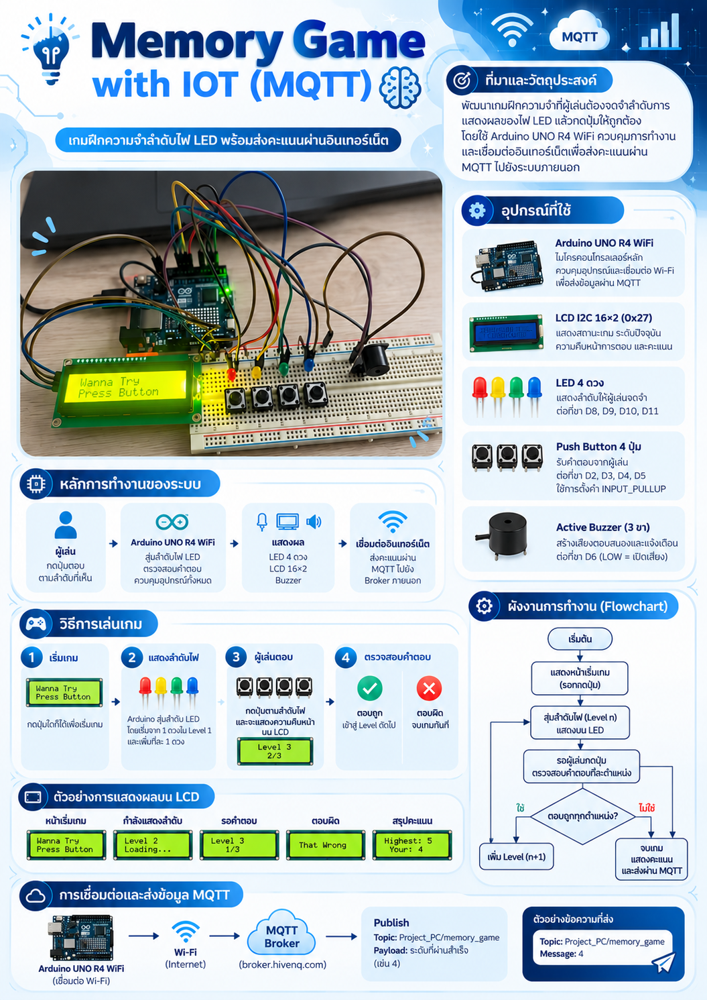

# Arduino_LED_Memory_Game
Physical Computing Project 2026 - IT KMITL
## Member
| Student ID | Name |
|--|--|
| 68070023 | นายชนวัตร แป้นคง |
| 68070061 | นายธนวิชญ์ วรรณทอง |
| 68070080 | นายนราวิชญ์ เหลืองประเสริฐ |
| 68070091 | นายบัญญพนธ์ เมฆเจริญวิวัฒนา |
## Overview
โปรเจกต์นี้เป็นเกมฝึกความจำ โดยผู้เล่นต้องจดจำลำดับการแสดงผลของไฟ LED จำนวน 4 ดวง และกดปุ่มให้ตรงตามลำดับที่แสดง ระบบจะเริ่มต้นจาก Level 1 และเพิ่มระดับความยากขึ้นเรื่อย ๆ โดยเพิ่มจำนวนลำดับไฟที่ต้องจดจำทีละหนึ่งตำแหน่ง สูงสุด 50 Level หากผู้เล่นตอบถูกทั้งหมดจะสามารถเข้าสู่ระดับถัดไป แต่หากตอบผิด เกมจะสิ้นสุดทันที ภายในโปรเจกต์มีการใช้จอ LCD I2C ขนาด 16×2 เพื่อแสดงสถานะเกม ระดับปัจจุบัน และคะแนนของผู้เล่น พร้อมทั้งใช้ Active Buzzer สำหรับสร้างเสียงตอบสนองและแจ้งเตือนเมื่อผู้เล่นตอบผิด และยังมีการนำเทคโนโลยี IoT มาประยุกต์ใช้ โดยเชื่อมต่อ Arduino เข้ากับเครือข่าย Wi-Fi และส่งคะแนนของผู้เล่นผ่าน MQTT Protocol ไปยัง Public MQTT Broker เพื่อให้ระบบภายนอกสามารถรับข้อมูลคะแนนได้
## Poster

